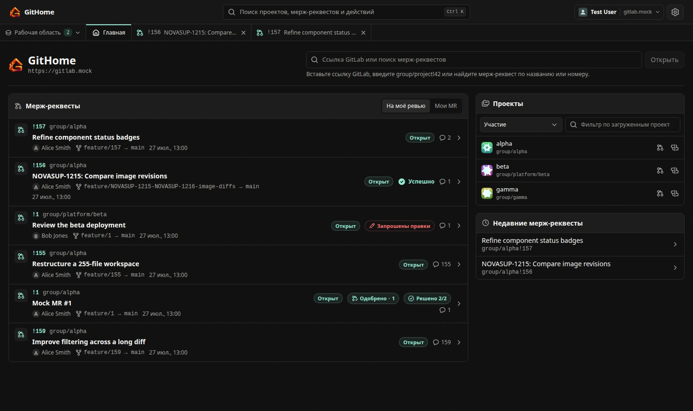
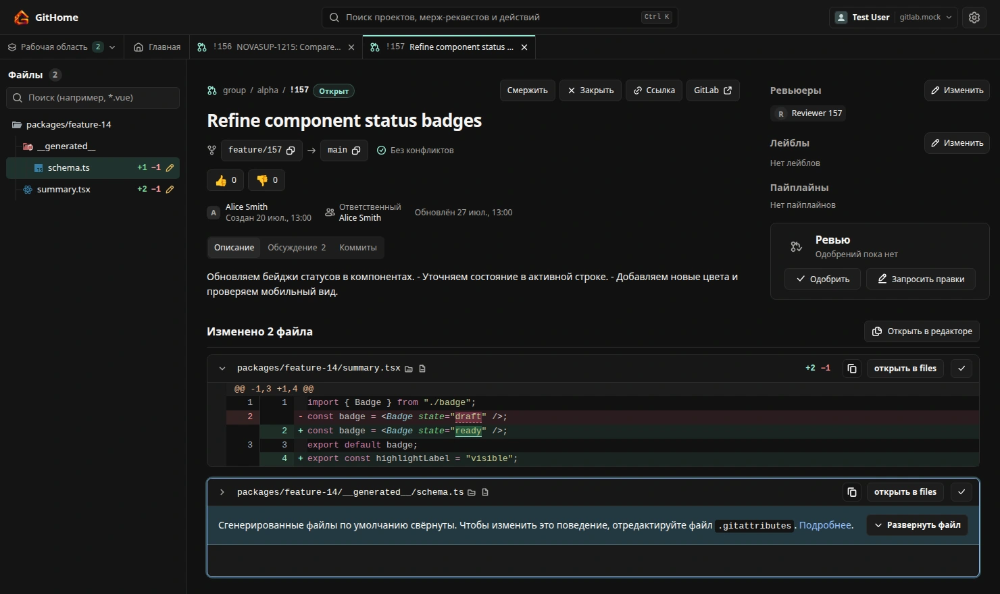
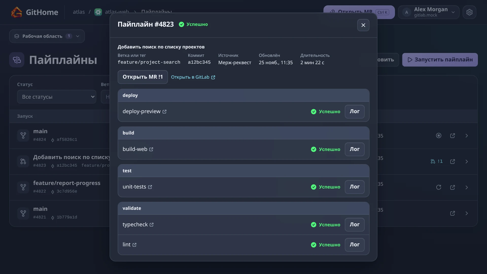
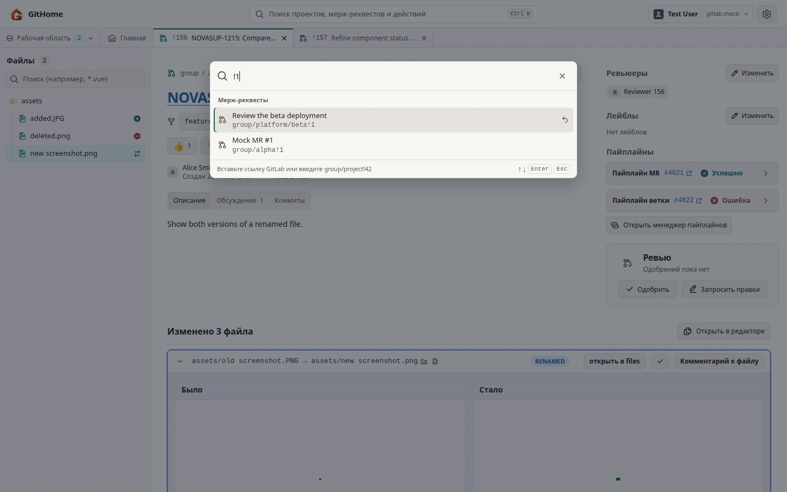

<p align="center">
  
</p>

<h1 align="center">GitHome</h1>

<p align="center">
  Клиент для ревью в GitLab и GitHub с базовой поддержкой Bitbucket Cloud.
</p>

<p align="center">
  <a href="https://github.com/js2me/githome/releases/latest"><strong>Скачать GitHome</strong></a>
  ·
  <a href="#первый-запуск">Первый запуск</a>
  ·
  <a href="https://github.com/js2me/githome/issues">Сообщить о проблеме</a>
</p>



## Что умеет GitHome

- **Собирает работу на главной.** Переключайтесь между «На моё ревью» и «Мои MR», фильтруйте проекты и возвращайтесь к недавно открытым мерж-реквестам.
- **Быстро открывает нужный экран.** Палитра `Ctrl+K` / `⌘K` ищет проекты по имени и пути, а MR — по названию и номеру. Можно вставить ссылку GitLab или набрать `group/project!42`.
- **Помогает делать ревью как в редакторе.** Держите несколько MR во вкладках, переходите по дереву изменённых файлов и смотрите полный diff прямо в обзоре. Ищите по изменениям, отмечайте просмотренные файлы и оставляйте комментарии к строкам.
- **Показывает структуру проектов.** Раскрывайте группы и подгруппы, переходите к файлам, мерж-реквестам и пайплайнам репозитория.
- **Управляет CI/CD прямо из MR.** Переключайтесь между запусками MR и связанным запуском ветки, смотрите граф этапов и логи, фильтруйте задачи по имени, этапу и статусу. При наличии прав GitLab запуск можно повторить или остановить.
- **Поддерживает несколько подключений.** Можно переключаться между аккаунтами на GitLab.com и на собственных серверах GitLab.

## Скачать

Откройте [последний релиз на GitHub](https://github.com/js2me/githome/releases/latest) и выберите файл в разделе **Assets**.

| Платформа | Файл |
| --- | --- |
| Linux | `.deb` для Debian и Ubuntu или `.AppImage` |
| macOS | `.dmg` |
| Windows | `.exe` |
| Android 7.0 и новее | `.apk` |

## Первый запуск

1. В своём GitLab [создайте персональный токен доступа](https://docs.gitlab.com/user/profile/personal_access_tokens/) с разрешением `api`, чтобы GitHome мог читать данные и выполнять действия от вашего имени, например оставлять комментарии.
2. В GitHome нажмите **Настроить подключение**, укажите адрес сервера (например, `https://gitlab.com`) и вставьте токен.
3. Нажмите **Подключить**. Откройте проект или выберите мерж-реквест на вкладке **На моё ревью**.

### GitHub и Bitbucket Cloud

Выберите провайдера в окне **Подключения**. Для GitHub.com нужен персональный токен с доступом к нужным репозиториям. У fine-grained токена для просмотра файлов должно быть право **Contents: Read**, а для отправки ревью — **Pull requests: Read and write**. Для Bitbucket Cloud укажите почту аккаунта Atlassian, идентификатор workspace из URL Bitbucket и API-токен с правами `read:user:bitbucket`, `read:repository:bitbucket`, `read:pullrequest:bitbucket` и `write:pullrequest:bitbucket` для отправки комментариев.

В GitHub доступны список PR с фильтрами, просмотр файлов по веткам, редактор дифов, комментарии к строкам и файлам, отправка ревью и отметки просмотренных файлов. Bitbucket Cloud поддерживает репозитории, открытые PR и обычные комментарии. Управление CI/CD доступно для GitLab.

## Открытие ссылок из других приложений

[Как открывать ссылки на проекты, MR и пайплайны из Paseo и других приложений в GitHome](docs/open-merge-request-links.md). Для этого можно настроить Chrome или передать ссылку напрямую через `--open-mr`, не меняя браузер по умолчанию.

## Скриншоты

На скриншотах показан интерфейс GitHome с демонстрационными данными.

### Рабочая область ревью



### Менеджер пайплайнов



### Палитра команд



## Разработка

Для запуска из исходников нужны Node.js 22 и pnpm.

```bash
pnpm install
pnpm dev
```

Откройте [localhost:1420](http://localhost:1420). Для запуска в Electron используйте `pnpm dev:electron`, для тестов — `pnpm test`.

[Подробнее об архитектуре, сборке и релизах](docs/development.md).
